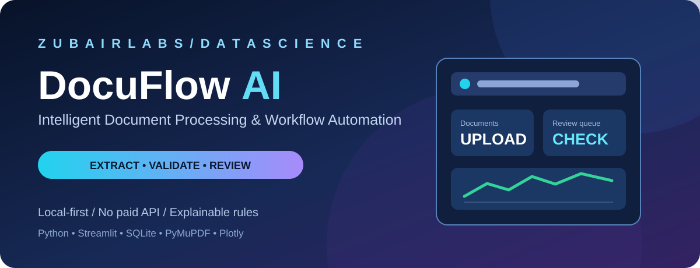
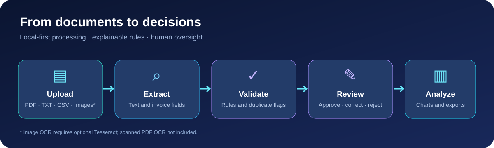
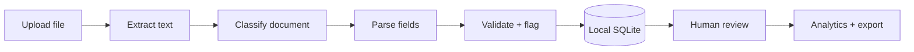

<div align="center">



# DocuFlow AI

### Intelligent Document Processing · Validation · Human Review · Analytics

**A local-first document intelligence portfolio prototype by [ZubairLabs](https://zubairlabs.com)**

[](https://docuflow-ai-zubairlabs.streamlit.app)

[](https://www.python.org/) [](https://streamlit.io/) [](https://sqlite.org/) [](https://github.com/muhammadzubair-data/docuflow-ai-intelligent-document-processing/actions/workflows/ci.yml) [](LICENSE)

**[Live demo](#-live-demo) · [Features](#-what-it-does) · [Quick start](#-quick-start) · [Architecture](#-processing-architecture) · [Limitations](#%EF%B8%8F-honest-limitations) · [Roadmap](#%EF%B8%8F-roadmap)**

</div>

> [!IMPORTANT]
> **Prototype, not an enterprise-ready AI service.** Document classification, extraction and risk flags use transparent rules, **not** a trained ML fraud detector. Sample invoices are synthetic. Use only nonsensitive or appropriately authorized files; the public demo is for synthetic documents only.

## 🌐 Live demo

**▶ [docuflow-ai-zubairlabs.streamlit.app](https://docuflow-ai-zubairlabs.streamlit.app)** — deployed on Streamlit Community Cloud (Python 3.12, `main` branch).

1. Open **Process documents** and click **Load 5 synthetic sample documents** (TXT, PDF and an OCR'd PNG invoice).
2. See the suspicious invoice flagged for a total mismatch, a high value and a duplicate invoice number.
3. Approve or reject records in **Review queue** (approval is blocked while validation issues remain).
4. Explore **Overview** charts and export CSV, Excel or JSON from **Data explorer**.

> [!NOTE]
> **Each visitor gets a private, temporary workspace.** The demo stores records in an in-memory database tied to your browser session: other visitors cannot see your documents, nothing is written to disk, and everything is erased when you reload or close the page (or click **Clear my session data**). Uploading your own files requires confirming they contain no confidential or personal data. If the app has been idle, it may take a minute to wake up.

## 🎯 The problem

Manual document handling is slow and error-prone: teams retype invoice details, compare totals, check duplicate identifiers, route exceptions for approval and assemble reports. DocuFlow AI demonstrates an **inspectable end-to-end workflow** to reduce repetitive steps while keeping a human in control.

## 🧩 What it does

| Stage | Current implementation | Why it matters |
|:--|:--|:--|
| 📥 Ingest | Text PDFs, TXT, CSV; optional image OCR | Accept common local formats |
| 🔎 Extract | PyMuPDF text extraction and invoice regex patterns | Convert text into fields |
| 🏷️ Classify | Keyword rules: invoice, receipt, contract, other | Organize records |
| 🧮 Validate | Required values, dates, subtotal/tax/total checks | Surface inconsistencies |
| 🚩 Flag | Duplicate vendor + invoice number, high-value threshold | Prioritize manual review |
| 👤 Review | Edit fields, approve or reject | Keep human oversight |
| 📊 Explore | Status charts, vendor totals, record explorer | See workflow activity |
| 📤 Export | CSV, XLSX and JSON | Reuse structured results |
| 💾 Store | Private in-memory SQLite per session (demo) or a local SQLite file | Isolate visitors; persist records on your own machine |

## 🎨 Processing architecture





## 🚀 Quick start

**Requirements:** Python 3.11 or later; local environment with access to package installation.

```bash
# 1. Clone the repository
 git clone https://github.com/muhammadzubair-data/docuflow-ai-intelligent-document-processing.git
 cd docuflow-ai-intelligent-document-processing

# 2. Create a virtual environment
 python -m venv .venv

# 3. Activate it
# Windows PowerShell: .venv\Scripts\Activate.ps1
# macOS / Linux: source .venv/bin/activate

# 4. Install and launch
 pip install -r requirements.txt
 streamlit run app.py
```

Open the URL shown by Streamlit, normally **http://localhost:8501**.

### Storage modes

| Mode | How to run | Where records go |
|:--|:--|:--|
| `session` (default) | `streamlit run app.py` | Private in-memory database per browser session; erased on reload. Used by the public demo. |
| `local` | `DOCUFLOW_STORAGE=local streamlit run app.py` (PowerShell: `$env:DOCUFLOW_STORAGE="local"; streamlit run app.py`) | SQLite file at `data/docuflow.db` (change with `DOCUFLOW_DB`); persists between runs. Single trusted user only. |

### Five-minute walkthrough

1. Open **Process documents** and click **Load 5 synthetic sample documents** (or upload a file from `sample_data/`).
2. Inspect extraction and validation messages.
3. Open **Review queue** to inspect source text, correct fields and save a decision.
4. Visit **Overview** to explore counts, review status and vendor totals.
5. Use **Data explorer** to export CSV, Excel or JSON.

### Optional image OCR

Install the Tesseract executable separately and add it to your system PATH, then install the Python bridge:

```bash
pip install pytesseract
```

PNG/JPG OCR is optional locally; the Streamlit Cloud deployment installs Tesseract through `packages.txt`. **Scanned PDF OCR is not supported** in this version; PDFs must contain selectable text. OCR output requires review.

## ☁️ Deploy to Streamlit Community Cloud

1. Sign in at [share.streamlit.io](https://share.streamlit.io) with GitHub → **Create app → Deploy a public app from GitHub**.
2. Repository `muhammadzubair-data/docuflow-ai-intelligent-document-processing`, branch `main`, main file `app.py`.
3. **Advanced settings:** Python 3.12. No secrets are needed.
4. Deploy. Streamlit Cloud installs `requirements.txt` and the Tesseract OCR system packages listed in `packages.txt`.

Keep the default `session` storage mode for any public deployment. Do **not** set `DOCUFLOW_STORAGE=local` on a shared server: every visitor would then read and write the same database.

## 🛠️ Technology stack

| Layer | Technology |
|:--|:--|
| UI | Streamlit |
| Data analysis and charts | Pandas, Plotly |
| PDF text extraction | PyMuPDF |
| Parsing, validation, flags | Python, regular expressions, deterministic rules |
| Persistence | SQLite (in-memory per session, or local file) |
| Exports | Pandas, openpyxl |
| Image OCR | Tesseract, pytesseract (`packages.txt` on Streamlit Cloud) |
| Quality checks | pytest, Streamlit AppTest, GitHub Actions (Python 3.11 + 3.12) |

## 🗂️ Repository structure

```text
docuflow-ai/
├── assets/
│   ├── hero.svg                  # Project cover
│   └── workflow.svg              # Illustrated processing pipeline
├── docuflow/
│   ├── __init__.py
│   ├── core.py                   # Extraction, parsing, validation and flags
│   └── db.py                     # SQLite persistence
├── sample_data/                  # Synthetic invoices: 3 TXT, 1 PDF, 1 PNG (OCR)
├── tests/
│   ├── test_core.py              # Extraction, validation, flags, database
│   └── test_demo_storage.py      # Session isolation, samples, OCR, app start-up
├── .github/workflows/ci.yml
├── .streamlit/config.toml        # 10 MB upload limit, XSRF protection
├── app.py                        # Streamlit application
├── packages.txt                  # Tesseract OCR for Streamlit Cloud
├── requirements.txt
├── .gitignore
├── LICENSE
└── README.md
```

## 🧪 Tests and reproducibility

```bash
python -m pytest -q
python -m compileall -q app.py docuflow
```

The GitHub Actions workflow installs Tesseract and runs the 13 tests plus a compile check on Python 3.11 and 3.12 for every push. The included sample documents are **synthetic**, not an independent real-world benchmark. No field-level extraction precision/recall or fraud-detection accuracy is claimed.

## 🔐 Local data and safety

- **Default (`session`) mode:** extracted text and fields live in an in-memory SQLite database per browser session. Visitors cannot see each other's records, nothing is written to disk, and records are deleted when the session ends.
- **`local` mode:** records are saved to a SQLite file at `data/docuflow.db`. Delete that file to remove them. Make backups first if needed.
- **Streamlit Community Cloud storage is temporary.** Its file system is reset when the app restarts or sleeps, so it is not durable or production-grade storage, even in `local` mode.
- Session isolation is not authentication: the app has **no login, role permissions, encryption at rest, malware scanning or audit log**. Uploaded files pass through the hosting provider's servers.
- CSV and Excel exports neutralise spreadsheet formulas (cells starting with `=`, `+`, `-`, `@`) taken from document text.
- Do **not** deploy this prototype publicly with confidential documents or sensitive user data.
- The high-value flag uses a demonstration threshold of **10,000 in extracted units**; it is **not** calibrated fraud detection and does not convert currencies.

## ⚠️ Honest limitations

| Area | Current boundary |
|:--|:--|
| Document layouts | Regex extraction can miss unusual layouts |
| Classification | Explainable keywords, not trained NLP |
| Fraud | Risk heuristics only; no validated fraud model |
| Scanned PDFs | OCR not implemented |
| Security | Per-session isolation only; no authentication or encryption at rest |
| Storage | Demo records are temporary; Streamlit Cloud storage is not durable |
| Performance | Not benchmarked at enterprise scale |
| Data | Synthetic demonstration invoices |

## 🛣️ Roadmap

- [ ] Add scanned-PDF OCR and layout-aware extraction
- [ ] Build labeled extraction benchmark with precision and recall
- [ ] Train and validate an anomaly model against real labels
- [ ] Add authentication, access controls and audit logs
- [ ] Add secure file handling and encrypted storage
- [ ] Support asynchronous processing and a REST API
- [ ] Add containerization and private deployment guides

## 💼 Portfolio case study

**Challenge:** Invoice-heavy workflows require manual entry, checking and review.

**Approach:** Create a local-first workflow for text extraction, structured parsing, validation, risk flags, human correction and export.

**Demonstration scenario:** Import synthetic invoices, examine a total mismatch, inspect a repeated invoice identifier, correct extracted values and export reviewed records.

**Value:** Shows how data engineering, rule-based intelligence, visualization and workflow design can combine into a practical prototype. It does not claim quantified time savings without measurement.

## 👨‍💻 Author

**ZubairLabs** · [Website](https://zubairlabs.com) · [GitHub](https://github.com/muhammadzubair-data)

## 📄 License

[MIT License](LICENSE) · © 2026 ZubairLabs
